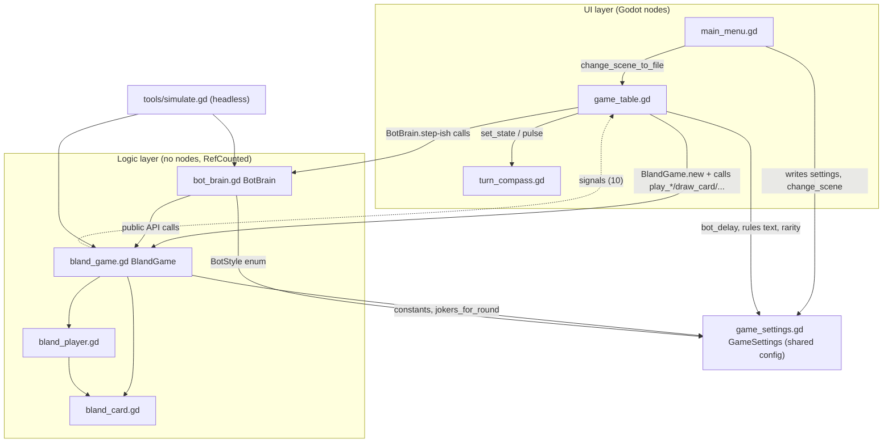
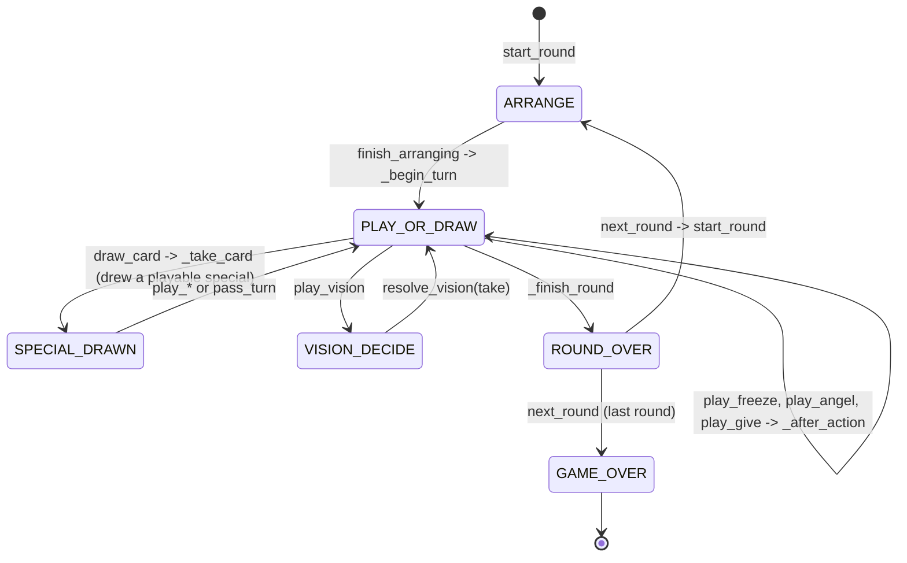

# BLANd – Program Map

Line numbers are as of 2026-10-22 and will drift while you refactor; the function names are the stable part.
Diagrams are Mermaid, so they render in GitHub, VS Code (Markdown preview) and Obsidian.

## 1. The tree (who owns what)

```
main_menu.tscn  (run/main_scene)  ──script──> main_menu.gd
│   writes GameSettings.num_rounds / bot_style / bot_delay / special_counts
│   _on_start() ── change_scene_to_file ──┐
│                                          ▼
│                          game_table.tscn ──script──> game_table.gd   (THE VIEW + controller, 1577 lines)
│                              │ _ready(): game = BlandGame.new(GameSettings.num_rounds)
│                              │           connects 10 BlandGame signals -> _on_* handlers
│                              │           game.start_round()
│                              │ _build_ui() builds seats, menu, buttons, compass
│                              ├── TurnCompass (Control, drawn in code)      <- set_state / pulse from _refresh
│                              └── BotBrain (static helper)                  <- called from _on_bot_timer / _bot_aim
│                                          │
│                                          ▼
│                                BlandGame (RefCounted – ALL rules, no UI)
│                                   ├── BlandPlayer x4   (hand, score, frozen_turns)
│                                   ├── BlandCard        (pair / special / joker)
│                                   └── reads GameSettings constants
│
GameSettings (RefCounted, static data + settings – acts like a global)
BotBrain     (static functions – decides what a bot does using BlandGame's public API)
tools/simulate.gd (headless: BlandGame + BotBrain, no scene) 
```

Not connected to any of the above: `Naila Version Game/` (separate prototype with its own main.gd / table_sprite.tscn),
`2. MainMenu/new_script.gd` (empty template), `1. CoreMechanics/simulate.gd` (byte-identical copy of `tools/simulate.gd`).

## 2. Layers



The important design fact: **BlandGame never touches UI**. It only emits signals. That is why `simulate.gd` works, and it is the seam to protect in the refactor.

## 3. Game phases (BlandGame.Phase)



(`IDLE` is the initial value before `start_round`.)

## 4. Signals: BlandGame -> game_table (connected in `_ready`, L97-106)

| Signal (emitted in BlandGame by) | Handler in game_table | What the handler does |
|---|---|---|
| `changed` (almost every state change) | `_queue_refresh` L825 -> `_flush_refresh` -> `_refresh` L838 | one batched redraw of every seat |
| `private_info` (play_angel, play_give, _take_card) | `_on_private_info` L1067 | toast for the human only |
| `pair_made` (`_check_new_pair`) | `_on_pair_made` L742 -> `_play_next_pair_animation` L751 | queued pair animation |
| `turn_started` (`_begin_turn`) | `_on_turn_started` L1215 | human: `_refresh`; bot: starts `_bot_timer` with `_bot_delay()` |
| `turn_continued` (`_after_action`) | `_on_turn_continued` L1226 | human: refresh; bot: keeps `_bot_player` so the timer continues |
| `special_drawn` (`_take_card`) | `_on_special_drawn` L1235 | human only: modal offering `_on_my_special` (play) or `game.pass_turn` (keep); bots ignored (the timer handles them) |
| `affected` (play_*, `_take_card`, `_end_turn`) | `_on_affected` L1315 -> `_toast` | pop-up alert for the target |
| `player_finished` (`_update_finished`) | `_on_player_finished` L1307 | toast |
| `round_over` (`_finish_round`) | `_on_round_over` L1351 | score modal -> `game.next_round()` L1370 |
| `game_over` (`next_round`) | `_on_game_over` L1374 | standings modal, "Main menu" |
| `log_message` (`_log`) | **not connected** | currently unused by the table |

simulate.gd connects only `round_over`.

## 5. Control flow: one human turn

1. `_refresh_seat` (L897) builds card buttons whose click callbacks call back into the table:
   - arranging: `_on_arrange_click` L1076 / `_enable_drag` L1095 -> `game.move_card`; buttons -> `game.shuffle_hand`, `game.finish_arranging`
   - drawing: `_on_draw` L1190 -> `game.draw_card`
   - playing a special: `_on_my_special` L1115 -> `game.play_skip` / `play_reverse` directly, or sets a `UiMode` (`CHOOSE_TARGET` ...) and waits
   - `_on_target_chosen` L1141 -> `play_freeze` / `play_angel` / `play_give` / `play_vision`
   - `_on_gift_chosen` L1132, `_on_vision_index` L1173 -> `play_give` / `play_vision`, then `resolve_vision` L1184
2. BlandGame mutates state and emits `changed` -> `_refresh` redraws -> next prompt via `_prompt_text` L1026.

## 6. Control flow: one bot turn

`_on_turn_started` -> `_bot_delay` -> bot Timer -> `_on_bot_timer` L1250, which switches on `game.phase`:

| Phase | Calls (game_table L1259-1272) |
|---|---|
| PLAY_OR_DRAW | `BotBrain.try_play_special`, else `_bot_aim` L1285 -> `BotBrain.choose_draw` (aim highlight) -> `BotBrain.draw` |
| SPECIAL_DRAWN | `BotBrain.try_play_special`, else `game.pass_turn` |
| VISION_DECIDE | `BotBrain.decide_vision` |

`BotBrain.try_play_special` -> `_random_plan` | `_basic_plan` (by `GameSettings.bot_style`) -> `_execute` -> `game.play_*`.

## 7. BlandGame internal call map (function -> what it calls)

Turn engine:
- `start_round` -> `_build_deck` (-> `BlandCard.make_pair/make_special/make_joker`), `_shuffle`, `_discard_starting_pairs` (-> `_discard_pair`, `BlandPlayer.find_match_for`), `_update_finished`, `_is_round_complete`, `_finish_round`
- `finish_arranging` -> `_begin_turn` -> `_step`, `_finish_round`
- `draw_card` -> `can_draw`, `can_draw_from` (-> `draw_targets`), `_take_card`, `_end_turn`
- `_take_card` -> `_check_new_pair` (-> `_discard_pair`, `find_match_for`), `can_play`, `_after_action`
- `_after_action` -> `_update_finished`, `_is_round_complete`, `_finish_round`, `_end_turn`, `draw_targets`
- `_end_turn` -> `_next_with_cards` (-> `_step`), `_update_finished`, `_is_round_complete`, `_finish_round`, `_begin_turn`
- `_draw_after_special` -> `_update_finished`, `_is_round_complete`, `_finish_round`, `_end_turn`, `draw_targets`
- `next_round` -> `start_round` or GAME_OVER

Specials (all start with `_consume` -> `can_play` -> `can_play_specials`, `valid_targets`):
- `play_skip`, `play_reverse` -> `_draw_after_special`
- `play_freeze`, `play_angel`, `play_give` -> `_after_action` (`play_give` also `_check_new_pair`)
- `play_vision` -> sets VISION_DECIDE; `resolve_vision` -> `_take_card` + `_after_action`
- `pass_turn` -> `_after_action`

Query helpers (called by UI and bots, change nothing): `can_draw`, `can_draw_from`, `can_play`, `can_play_specials`, `is_turn_of`, `valid_targets`, `draw_targets`, `upcoming_player`, `pairs_left`, `paired_count_by_rank`.

Private helpers: `_log`, `_n`, `_poss`, `_you_grammar`, `_shuffle`, `_step`.

## 8. game_table.gd internals (grouped; "<-" = called by)

| Group | Functions | Entry point |
|---|---|---|
| Setup | `_ready`, `_build_ui`, `_make_seat`, `_layout_middle`, `_layout_side_cards`, `_apply_responsive_scale`, `_set_scaled_font_size`, `_on_viewport_resized` | `_ready` |
| Menu / pause | `_toggle_menu_popup`, `_add_menu_item`, `_on_menu_*`, `_confirm_action`, `_toggle_pause`, `_set_paused` | `_build_ui`, `_unhandled_input` |
| Rendering | `_refresh` (<- 12 callers) -> `_refresh_seat`, `_fit_status_text`, `_prompt_text`; card drawing: `_card_view` (<- `_refresh_seat`, `_play_next_pair_animation`, `_show_modal`) -> `_tex`, `_add_special_overlay`, `_card_tooltip`; `_pair_chip`, `_small_label`, `_box` | `_flush_refresh` |
| Human input | `_on_arrange_click`, `_enable_drag`, `_on_draw`, `_on_my_special`, `_on_gift_chosen`, `_on_target_chosen`, `_on_vision_index`, `_cancel_selection`, `_clear_selection` | button callbacks made in `_refresh_seat` / `_make_seat` |
| Bot driver | `_on_bot_timer`, `_bot_aim`, `_bot_delay` | bot timer |
| Game event handlers | the `_on_*` table in section 4, plus `_toast` | signals |
| Modals / overlays | `_show_modal` (<- 8 callers) -> `_make_overlay`, `_close_modal`; `_show_tracker`, `_show_rules`, `_cell` | various |

## 9. What other files reference from BlandGame / GameSettings

- game_table -> BlandGame calls (with lines): `start_round` 107, `finish_arranging` 274, `shuffle_hand` 268, `move_card` 1088/1110, `draw_card` 1193/1261/1288, `can_draw` 941/1009/1259, `can_draw_from` 941/1260, `can_play` 987, `can_play_specials` 1061, `valid_targets` 939, `play_skip` 1118, `play_reverse` 1120, `play_freeze` 1160, `play_angel` 1163, `play_give` 1169, `play_vision` 1177, `resolve_vision` 1184-1185, `pass_turn` 280/1242/1270, `next_round` 1370, `is_turn_of` 864, `upcoming_player` 842/907, `pairs_left` 848, `paired_count_by_rank` 1520.
- GameSettings consumers: main_menu (writes all four settings), game_table (`bot_delay`, `bot_style`, `BOT_SPEEDS`, `FAST_FORWARD_DELAY`, `rarity_*`, `RULES_TEXT`, `PAIR_RANKS`, `total_specials`, `num_rounds`), bland_game (`MIN/MAX_ROUNDS`, `NUM_PLAYERS`, `PAIR_RANKS`, `special_counts`, `jokers_for_round`, `POINTS_PER_PAIR`, `JOKER_PENALTY`, `FREEZE_TURNS`), bot_brain (`BotStyle`), simulate (`BotStyle`).
- BlandCard / BlandPlayer: created only inside BlandGame (`_init`, `_build_deck`); read everywhere.
- TurnCompass: created in `game_table._build_ui` L242; driven by `_refresh` L857/861.

## 10. Refactor observations

- `game_table.gd` is ~38% of the code and mixes five jobs (layout, rendering, input state machine via `UiMode`, bot driving, modals). The groups in section 8 are natural seams for splitting.
- `GameSettings` is global mutable state read by logic (BlandGame) and UI. Passing settings into `BlandGame._init` instead of reading statics would make the logic layer fully self-contained.
- `log_message` is emitted but never connected.
- Duplicates / dead files listed at the end of section 1.
